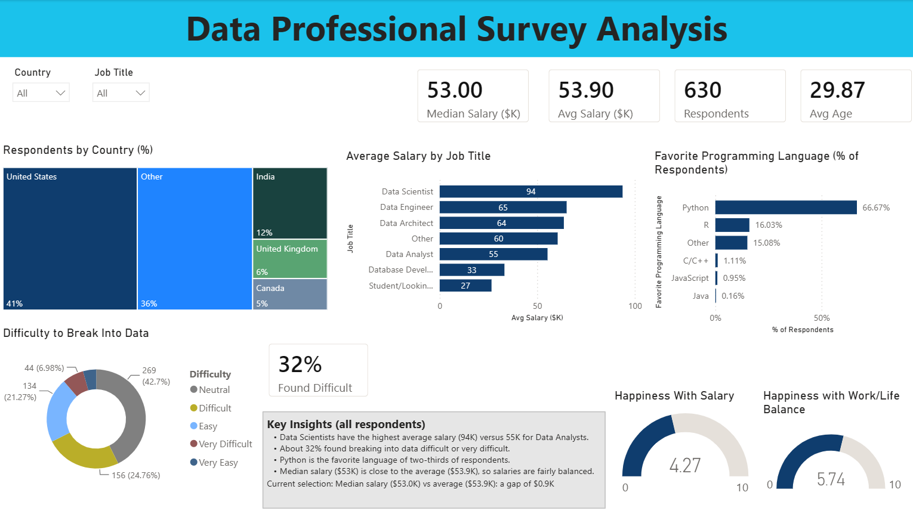

# Data Professional Survey Analysis

An interactive Power BI dashboard analysing a survey of 630 data professionals:
salaries by role, where respondents live, favorite programming languages, how
difficult it was to break into data, and job happiness.

## Business questions
- Which data roles earn the most?
- Where do respondents live, and which programming language do they prefer?
- How difficult did people find it to break into data?
- How happy are respondents with their salary and work/life balance?

## Dataset
Source: [Alex the Analyst, Power BI course](https://github.com/AlexTheAnalyst/Power-BI/blob/main/Power%20BI%20-%20Final%20Project.xlsx) (Data Professional Survey).
630 respondents. Salary is reported as a range, so each respondent's salary is
the midpoint of their range, in thousands of USD. Figures are approximate.

The salary cleaning followed the course steps. The dashboard layout, DAX measures,
slicers and insights are my own additions.

## Data preparation (Power Query)
- Renamed long survey-question columns to short names (Country, Job Title, Difficulty, etc.)
- Converted the salary range column into one numeric value: split the range into
  lower and upper bounds, removed "K" and dashes, set the open-ended top bracket
  ("225K plus") to 225, changed the types to whole numbers, and calculated the
  midpoint as (lower + upper) / 2
- Replaced "Neither easy nor difficult" with "Neutral" in the Difficulty column
- Removed columns not used in the report, including personal data (email, ethnicity, gender)

## DAX measures
- **Respondents**: number of survey respondents
- **Avg Age**: average age of respondents
- **Avg Salary** and **Median Salary**: average and median salary in $K
- **% Found Difficult**: share who answered "Difficult" or "Very Difficult"
- **Avg Happy Salary** and **Avg Happy WorkLife**: average happiness scores (0-10)
- **Salary Insight**: dynamic text that updates with the slicers

## Key insights
- Data Scientists have the highest average salary (94K) versus 55K for Data Analysts.
- About 32% found breaking into data difficult or very difficult.
- Python is the favorite language of about two-thirds of respondents.
- Median salary ($53K) is close to the average ($53.9K), so salaries are fairly balanced.
- Salaries are range midpoints, so the averages and medians are approximate.

## Interactivity
The Country and Job Title slicers filter every visual and card.

## How to open
Download the `.pbix` file from this repository and open it in Power BI Desktop
(free for Windows).

## Skills demonstrated
Power Query data cleaning, DAX measures, interactive dashboard design, and data storytelling.
